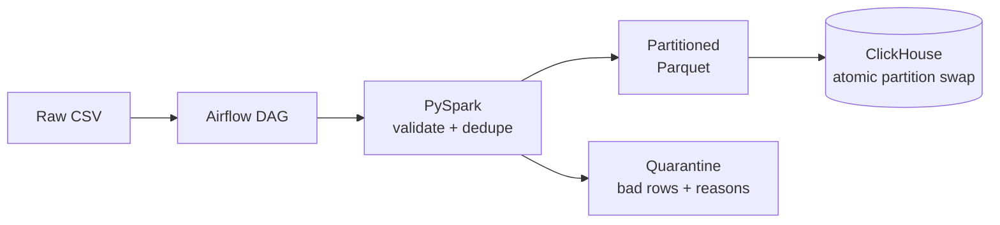

<h1 align="center">Hi, I'm Rihan Bagwan 👋</h1>
<h3 align="center">Data Engineer · DevOps & Linux · Python</h3>

  
  
  
  

I'm a software engineer with **3+ years of experience**. For the last year I've focused on **data engineering**: I build
Python, PySpark and Airflow pipelines that load **15–20 GB a day into ClickHouse**, and I deploy and run them myself
on **RHEL Linux with Docker**.

### What I do

- 🛠️ **Build data pipelines.** I run 12+ ETL/ELT pipelines that pull from databases, REST APIs and CSV/XLSX/PDF files into ClickHouse (about 5M records a day).
- ✅ **Make data trustworthy.** Schema inference, validation and normalization cut rejected records by **~30%**.
- 🔁 **Make pipelines recover on their own.** Async ingestion with Celery, Redis and DuckDB, with retries and data recovery, cut failed loads by **~40%**.
- ⚙️ **Run what I build.** I handle Docker, RHEL administration, systemd/cron, Bash automation, CI/CD and log-driven troubleshooting. Fixing a memory bottleneck that caused job failures is part of the job.

### ⭐ Featured project

#### [batch-data-pipeline](https://github.com/the-iconic-rihan/batch-data-pipeline): Airflow → PySpark → Parquet → ClickHouse

An Airflow pipeline that ingests ~1M rows a day, validates and deduplicates them with PySpark, quarantines bad
rows with the reason they failed, and loads ClickHouse with an **atomic partition swap**, so re-runs never create
duplicates. You can start it with one command (`make up`), and GitHub Actions CI runs lint, PySpark unit tests,
a Docker build and a DAG integrity test on every push.

### 🧰 Tech stack

**Data engineering** 

**Databases** 

**DevOps & cloud** 

**Backend** 

### 💼 Experience

| Role | Company | When | Focus |
|---|---|---|---|
| Software Development Engineer | Skillmine Technology Consulting | Nov 2025 – Present | ETL/ELT into ClickHouse, PySpark, Airflow, Celery, Docker on RHEL |
| Software Development Engineer | Reliance Jio Platforms | Jan 2024 – Nov 2025 | Data ingestion & sync, SQL tuning (−25% latency), Python/Bash automation on RHEL |
| Software Development Engineer | Dimensionless Technologies | Aug 2023 – Jan 2024 | GPT-3.5 automation, LLM data prep, real-time backends (WebSockets, asyncio) |

🎓 B.Tech in Computer Science, GH Raisoni College of Engineering and Management, Pune (2019–2023) 
📄 Paper: *"GitHub Issue Manager System for Rank-Based Profile"*, ICET-23

---

Repositories from before 2023 are college and learning projects (web development, Python games). I've kept them as a record of where I started.
