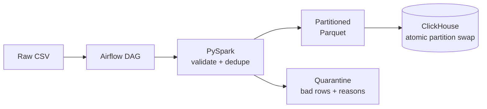

<picture>
  <source media="(prefers-color-scheme: dark)" srcset="assets/banner-dark.svg">
  
</picture>

<p align="center">
  <a href="https://the-iconic-rihan.github.io/Portfolio/"></a>
  <a href="https://www.linkedin.com/in/rihanbagwan/"></a>
  <a href="mailto:rihanbagwan98@gmail.com"></a>
  <a href="https://the-iconic-rihan.github.io/Portfolio/assets/Rihan_Bagwan_Resume.pdf"></a>
</p>

<p align="center">
  
  <br/>
  
  
</p>

## 👋 About me

I'm a software engineer with **3+ years of experience**. For the last year I've focused on **data engineering**:
Python, PySpark and Airflow pipelines that load **15–20 GB a day into ClickHouse**, which I also deploy and
run myself on **Linux with Docker**.

```yaml
name: Rihan Bagwan
role: Data Engineer · DevOps & Linux
location: Mumbai, India
now: Software Development Engineer @ Skillmine Technology Consulting
building:
  - ETL/ELT pipelines from databases, REST APIs and CSV/XLSX/PDF into ClickHouse
  - PySpark batch jobs orchestrated by Airflow (8 DAGs)
  - async ingestion with Celery, Redis and DuckDB
care_about: [data quality, idempotent re-runs, pipelines that recover on their own]
preferred_locations:
  india: [Mumbai, Navi Mumbai, Pune, Hyderabad, Bangalore]
  relocation: [USA, UK, Europe, Singapore, Australia]
open_to: [Data Engineering, DevOps, Platform Engineering]
```

## 📈 Impact at a glance

<table align="center">
  <tr>
    <td align="center" width="160"><h3>15–20 GB</h3><sub>processed daily<br/>into ClickHouse</sub></td>
    <td align="center" width="160"><h3>12+</h3><sub>production<br/>ETL/ELT pipelines</sub></td>
    <td align="center" width="160"><h3>−40%</h3><sub>failed loads, via<br/>retries &amp; recovery</sub></td>
    <td align="center" width="160"><h3>−30%</h3><sub>rejected records,<br/>via validation</sub></td>
    <td align="center" width="160"><h3>−25%</h3><sub>SQL query<br/>latency</sub></td>
  </tr>
</table>

## ⭐ Featured project

<table>
  <tr>
    <td>
      <h3><a href="https://github.com/the-iconic-rihan/batch-data-pipeline">batch-data-pipeline</a></h3>
      <p>
        <a href="https://github.com/the-iconic-rihan/batch-data-pipeline/actions/workflows/ci.yml"></a>
      </p>
      <p>
        An Airflow pipeline that ingests <b>~1M rows a day</b>, validates and deduplicates them with <b>PySpark</b>,
        quarantines bad rows with the reason they failed, and loads <b>ClickHouse</b> through an
        <b>atomic partition swap</b>, so re-running a day never creates duplicates.
      </p>
      <ul>
        <li>✅ Data-quality gate: if more than 5% of a batch is bad, nothing is published</li>
        <li>🔁 Idempotent, incremental loads: one run = one day, safe to re-run or backfill</li>
        <li>📊 Every run's counts, errors and timings are recorded in a <code>pipeline_runs</code> table</li>
        <li>🐳 One-command setup with Docker Compose · ⚙️ GitHub Actions CI with PySpark tests</li>
      </ul>
      <p>
        
        
        
        
        
        
        
      </p>
    </td>
  </tr>
</table>



## 🧰 Tech stack

<table>
  <tr>
    <td width="170"><b>Languages</b></td>
    <td>
      
      
      <br/>
      <sub>Python · SQL · Bash · YAML</sub>
    </td>
  </tr>
  <tr>
    <td width="170"><b>Data engineering</b></td>
    <td>
      
      
      
      
      
      
      
      
      <br/>
      <sub>PySpark · Apache Airflow · Apache Kafka · RabbitMQ · Celery · Pandas · NumPy · DuckDB · Parquet · dbt</sub><br/>
      <sub><i>Concepts: ETL / ELT · Batch &amp; streaming · CDC · Data modeling (star / snowflake) · Data quality · Incremental loads · Partitioning · Data lake / lakehouse</i></sub>
    </td>
  </tr>
  <tr>
    <td width="170"><b>Databases &amp; storage</b></td>
    <td>
      
      
      
      
      
      
      
      <br/>
      <sub>ClickHouse · PostgreSQL · MySQL · MongoDB · Elasticsearch · Redis · SQLite · DynamoDB</sub>
    </td>
  </tr>
  <tr>
    <td width="170"><b>Python backend</b></td>
    <td>
      
      
      
      
      
      
      
      <br/>
      <sub>FastAPI · Django · Flask · SQLAlchemy · Pydantic · REST APIs · GraphQL · WebSockets · asyncio · pytest · Swagger / OpenAPI · Selenium · Playwright</sub>
    </td>
  </tr>
  <tr>
    <td width="170"><b>DevOps &amp; CI/CD</b></td>
    <td>
      
      
      
      
      
      <br/>
      <sub>Docker · Docker Compose · Kubernetes · GitHub Actions · Jenkins · GitLab CI · Nginx</sub>
    </td>
  </tr>
  <tr>
    <td width="170"><b>Monitoring &amp; observability</b></td>
    <td>
      
      
      
      <br/>
      <sub>Prometheus · Grafana · ELK stack (Elasticsearch, Logstash, Kibana)</sub>
    </td>
  </tr>
  <tr>
    <td width="170"><b>AWS</b></td>
    <td>
      <br/>
      <sub>S3 · EC2 · Lambda · RDS</sub>
    </td>
  </tr>
  <tr>
    <td width="170"><b>Azure</b></td>
    <td>
      <br/>
      <sub>Blob Storage / ADLS Gen2 · Azure DevOps</sub>
    </td>
  </tr>
  <tr>
    <td width="170"><b>Linux &amp; shell tools</b></td>
    <td>
      
      
      
      <br/>
      <sub>Ubuntu · systemd · cron · SSH · rsync · grep / sed / awk · htop · apt · vim · tmux</sub>
    </td>
  </tr>
  <tr>
    <td width="170"><b>Developer tools</b></td>
    <td>
      
      
      
      
      
      
      <br/>
      <sub>VS Code · PyCharm · Postman · Git · GitHub · Jira · Jupyter</sub>
    </td>
  </tr>
  <tr>
    <td width="170"><b>Engineering practices</b></td>
    <td>
      <sub>Microservices · REST API design · Event-driven architecture · Message queues · Caching · CI/CD · Infrastructure as Code · Containerization · OOP &amp; design patterns · System design · Unit &amp; integration testing · Code review · Agile / Scrum</sub>
    </td>
  </tr>
</table>

## 💼 Experience

| | Role | Focus |
|:--|:--|:--|
| **Nov 2025 – Present** | **Software Development Engineer** · Skillmine Technology Consulting | ETL/ELT into ClickHouse (15–20 GB/day), PySpark, Airflow, Celery, FastAPI, Docker on Linux |
| **Jan 2024 – Nov 2025** | **Software Development Engineer** · Reliance Jio Platforms | Data ingestion &amp; sync, SQL tuning (−25% latency), Django, Python/Bash automation on Linux |
| **Aug 2023 – Jan 2024** | **Software Development Engineer** · Dimensionless Technologies | GPT-3.5 automation (+35% efficiency), LLM data prep, real-time backends (WebSockets, asyncio) |

## 🎓 Education & publication

- **B.Tech in Computer Science**, GH Raisoni College of Engineering and Management, Pune (2019–2023)
- **Paper:** *"GitHub Issue Manager System for Rank-Based Profile"*, ICET-23

---

<p align="center">
  <b>Hiring for data engineering or DevOps?</b> I'd be glad to talk:
  <a href="mailto:rihanbagwan98@gmail.com">rihanbagwan98@gmail.com</a>
  <br/><br/>
  <sub>Repositories from before 2023 are college and learning projects. I've kept them as a record of where I started.</sub>
</p>
